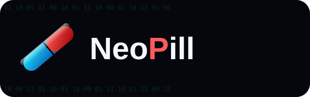

<p align="center">
  
</p>

<p align="center">
  <a href="https://buymeacoffee.com/bigurka"></a>
</p>

<p align="center">
  🇮🇹 <a href="#italiano">Italiano</a> · 🇬🇧 <a href="#english">English</a>
</p>

---

<a id="italiano"></a>

# NeoPill (Italiano)

Integrazione custom per Home Assistant (compatibile [HACS](https://hacs.xyz)) per la gestione dei farmaci
di uno o più pazienti: assunzioni, scorte, rifornimenti e promemoria dose, con un calendario nativo HA per
paziente e un dispositivo HA per ogni farmaco.

> Stato: v0.17.0, in sviluppo attivo. Le funzionalità descritte qui sotto sono tutte implementate; non ancora
> testata a fondo su un uso quotidiano reale (vedi [Stato del progetto](#stato-del-progetto)).

## Funzionalità

- Gestione multi-paziente. Ogni paziente ha un device hub **"‹Nome› NeoPill"** che raccoglie le entità
  trasversali (calendario, sensore farmaci-da-rifornire, pulsanti raggruppati per ora di assunzione) ed è
  il "genitore" (via_device) dei device dei suoi farmaci.
- Ogni farmaco è un dispositivo HA a sé, nominato `"‹Farmaco› (‹Paziente›)"`, con entità per scorta,
  prossima assunzione, giorni di scorta rimanenti, stato "da assumere" e stato "scorta in esaurimento". Due
  pazienti diversi con un farmaco dallo stesso nome restano completamente indipendenti (scorte, orari,
  storico separati, device ed entity_id distinti). È possibile indicare anche un **nome completo**
  opzionale (es. principio attivo e dosaggio) usato nei promemoria e nelle email di rifornimento al posto
  del nome breve.
- **entity_id in inglese, stabili, sempre prefissati con il paziente** (prime 3 consonanti del nome, es.
  `mrr` per "Mario Rossi", con gestione automatica delle collisioni) — calcolati una sola volta alla
  creazione del paziente e stabili nel tempo anche se lo rinomini dopo, per non rompere
  automazioni/dashboard.
- **Nomi visualizzati e interfaccia del pannello localizzati**: i nomi delle entità ("Scorta", "Assumi
  ora", ...) e il pannello stesso seguono la lingua configurata in Home Assistant (italiano se
  `hass.language` è italiano, inglese altrimenti) — nessuna configurazione da fare, cambia da solo.
- Eliminando un paziente vengono rimossi automaticamente tutti i suoi farmaci, il calendario e le altre
  entità collegate (cancellazione a cascata tramite il device hub del paziente).
- Dosaggio a orari fissi al giorno, a giorni della settimana con orari indipendenti giorno per giorno (es.
  martedì e venerdì, con orari diversi tra loro), oppure a intervallo dall'ultima assunzione — con dose
  anche frazionaria (es. 1/2, 1/4).
- Rifornimento per quantità diretta o per numero di confezioni.
- **Pulsanti raggruppati per ora di assunzione**: per ogni orario in comune tra i farmaci di un paziente
  (orari fissi o giorni della settimana) vengono creati automaticamente due pulsanti — "Assumi tutti ore
  HH:MM" e "Segna tutti non assunti ore HH:MM" — che agiscono in un colpo solo su tutti i farmaci di quel
  paziente previsti a quell'orario. Creati/rimossi automaticamente quando aggiungi, modifichi o elimini un
  farmaco.
- **Finestra ideale di riordino, per paziente**: due soglie (giorni minimi/massimi, editabili dalla toolbar
  del pannello) pensate per raggruppare più farmaci possibile in un'unica commissione — minimi = non
  aspettare oltre (rischio di rimanere senza), massimi = non troppo presto (rischio di rifiuto del medico
  per prescrizione anticipata). Il sensore per paziente `sensor.‹slug›_restock_reminder` non segnala nulla
  finché nessun farmaco ha raggiunto il minimo; nel momento in cui il primo lo raggiunge, include **tutti**
  i farmaci attualmente nella finestra (non solo quello che ha fatto scattare l'avviso), per riunirli nello
  stesso ordine (vedi [Blueprint pronte all'uso](#blueprint-pronte-alluso) per i dettagli e come collegarlo
  a una notifica/email).
- Ogni card farmaco nel pannello mostra anche il contenuto della confezione e la data di esaurimento
  scorta prevista; le azioni quotidiane (assumi, segna non assunta, modifica, rifornisci) sono pulsanti a
  icona (la pillola a due colori del logo, con un badge overlay) invece che testo.
- Tutta la gestione (pazienti, farmaci, assunzioni, rifornimenti) avviene da un pannello dedicato nella
  sidebar di Home Assistant, separato da Lovelace: i farmaci del paziente selezionato sono mostrati come
  tile in griglia, non come un semplice elenco.
- Servizi Home Assistant (`neopill.assumi_farmaco`, `neopill.segna_non_assunta`, `neopill.rifornisci_farmaco`,
  `neopill.segna_rifornimento_notificato`, `neopill.correggi_assunzione`) per l'uso da automazioni, e tre
  [blueprint](#blueprint-pronte-alluso) pronte all'uso per i promemoria di assunzione, di rifornimento e per
  correggere un'assunzione registrata per errore con scorta a zero.
- **Fasce orarie a colori**: una legenda nella parte alta del pannello mostra un colore per ogni orario di
  assunzione in uso; lo stesso colore tinteggia le righe corrispondenti nello storico, per riconoscere a
  colpo d'occhio assunzioni fuori orario o mancate.
- **Card Lovelace + dashboard automatica**: oltre al pannello dedicato, è disponibile una card riepilogo
  per paziente (`custom:neopill-patient-card`) da aggiungere su qualsiasi dashboard esistente, e una
  [strategy](#card-e-dashboard-lovelace) che genera automaticamente una dashboard con una vista per
  paziente, senza posizionare nulla a mano. Card e strategy si registrano da sole, nessuna risorsa Lovelace
  da aggiungere manualmente.

## Installazione

### Tramite HACS (consigliato)

NeoPill è nello store ufficiale di HACS: non serve aggiungere repository personalizzate.

1. HACS → cerca **NeoPill** → Scarica.
2. Riavvia Home Assistant.
3. Impostazioni → Dispositivi e servizi → Aggiungi integrazione → **NeoPill**.

Alla prima installazione NeoPill crea in automatico un paziente per ogni utente Home Assistant **non
amministratore**, collegato a quell'utente (vedi [Permessi e ruoli](#permessi)).

**Se l'avevi installata come repository personalizzata** (versioni precedenti): in HACS → menu (⋮) →
Repository personalizzate, rimuovi solo la voce `bigurka/neopill` — **non** l'integrazione. I dati restano in
`.storage/neopill.data` e non dipendono da HACS; da quel momento gli aggiornamenti arrivano dallo store.

### Manuale

Copia la cartella `custom_components/neopill` nella cartella `config/custom_components/` della tua
installazione Home Assistant, poi riavvia.

### Rimozione

1. Impostazioni → Dispositivi e servizi → **NeoPill** → menu (⋮) → **Elimina**: spariscono pannello,
   dispositivi ed entità.
2. HACS → NeoPill → menu (⋮) → **Rimuovi** (oppure, se installata a mano, cancella la cartella
   `config/custom_components/neopill`), poi riavvia Home Assistant.
3. I dati (pazienti, farmaci, storico) restano nel file `config/.storage/neopill.data`: se reinstalli
   NeoPill vengono ritrovati. Per cancellarli definitivamente elimina quel file a Home Assistant spento.

Le automazioni create dalle blueprint NeoPill vanno eliminate a parte (Impostazioni → Automazioni).

## Utilizzo

Dopo l'installazione, l'integrazione aggiunge una voce **NeoPill** nella sidebar. In alto nel pannello c'è
una toolbar (di dimensioni generose, ben leggibile) con: icona per aggiungere un paziente, selettore del
paziente attivo, i campi "Giorni minimi"/"Giorni massimi" della finestra di riordino di quel paziente (si
salvano da soli quando esci dal campo, con validazione), icona per rinominare il paziente, icona per
aggiungere un farmaco e icona per eliminare il paziente selezionato. Sotto, i farmaci del paziente come
tile in griglia, ciascuna con tutte le azioni quotidiane (assumi ora, segna come non assunta, rifornisci,
modifica, elimina) — disponibili anche come entità/servizi standard di Home Assistant.

Accanto al selettore compare il tuo **ruolo** sul paziente selezionato: pulsanti e campi che il ruolo non
permette non vengono mostrati. Gli amministratori hanno in più, a destra della toolbar, le icone per
**importare gli utenti HA** come pazienti, gestire gli **accessi** del paziente selezionato e le
**impostazioni** (tra cui *Mostra NeoPill nella barra laterale*).

Se la voce nella barra laterale è nascosta, il pannello resta raggiungibile dal link **Visita** nella pagina
del dispositivo "‹Nome› NeoPill" del paziente (Impostazioni → Dispositivi), che lo apre direttamente su quel
paziente, o dall'indirizzo `/neopill`.

## Card e dashboard Lovelace

<a id="card-e-dashboard-lovelace"></a>

Oltre al pannello dedicato nella sidebar, NeoPill offre anche una card e una dashboard "strategy" per
Lovelace, pensate per chi vuole vedere i farmaci di un paziente insieme al resto delle proprie dashboard.
Si registrano da sole al riavvio di Home Assistant (nessun passaggio manuale in Impostazioni → Dashboard →
Risorse).

**Solo la card**, su una dashboard esistente: Modifica dashboard → Aggiungi card → cerca "NeoPill" → **NeoPill
- Riepilogo paziente** → scegli il paziente dal menu a tendina dell'editor. La card mostra i farmaci da
assumere ora (con pulsanti rapidi "assumi"/"non assunta" per il singolo farmaco, più due pulsanti accanto al
titolo della sezione per assumere/segnare non assunti **tutti insieme** — lo stesso concetto dei pulsanti
per fascia oraria del pannello, applicato a tutto ciò che è dovuto in quel momento), la prossima dose per gli
altri farmaci, ed eventuali farmaci con scorte in esaurimento, con un link per aprire il pannello completo.

C'è anche una seconda card, **NeoPill - Situazione scorte** (`custom:neopill-stock-card`), che non richiede
configurazione: una tabella separata per paziente (ordinate per giorni di scorta rimanenti crescenti
all'interno di ciascuna), con le righe sotto soglia evidenziate.

**Dashboard automatica** (una vista per paziente più una vista scorte, generate da sole, niente card da
posizionare a mano): crea una nuova dashboard, passa alla modalità YAML e usa:

```yaml
strategy:
  type: custom:neopill
views: []
```

La dashboard genererà automaticamente una vista per ciascun paziente esistente (titolo = nome del paziente,
con la card riepilogo), più una vista finale **"Scorte"** con la tabella di tutti i farmaci di tutti i
pazienti. Aggiungendo o eliminando un paziente dal pannello NeoPill, ricarica la dashboard per aggiornare
l'elenco delle viste.

## Blueprint pronte all'uso

<a id="blueprint-pronte-alluso"></a>

Nel repository, sotto `blueprints/automation/bigurka/`, ci sono tre blueprint di automazione Home Assistant
pronte all'uso (nessuna scrittura di YAML richiesta). Per importarle: Impostazioni → Automazioni e scene →
Blueprint → Importa blueprint, incollando l'URL della pagina GitHub del file, ad esempio:
`https://github.com/bigurka/neopill/blob/main/blueprints/automation/bigurka/neopill_dose_reminder.yaml`.

### `neopill_dose_reminder.yaml` — Promemoria assunzione farmaci

Monitora uno o più sensori "da assumere" (`binary_sensor.‹farmaco›_dose_due`) e invia **una sola notifica
push cumulativa** — non una per farmaco — con l'elenco di tutto ciò che è dovuto in quel momento e due
pulsanti, "Assumi tutti" / "Non assunto", che agiscono su tutto l'elenco insieme. Se non rispondi, la
notifica si ripete a intervalli regolari (ricalcolando ogni volta l'elenco ancora dovuto); se nel frattempo
un altro farmaco diventa dovuto, la notifica si aggiorna **subito**, senza aspettare la ripetizione
successiva; quando non c'è più nulla di dovuto (hai risposto, o hai già segnato le dosi dal pannello), la
notifica viene rimossa automaticamente dal telefono.

**Configurazione consigliata**: una sola automazione per paziente, con *tutti* i sensori `dose_due` di quel
paziente selezionati nel campo "Sensori 'Da assumere'" — non serve decidere tu le fasce orarie: il
raggruppamento avviene da solo, istante per istante, in base a cosa è effettivamente dovuto in ogni
momento (se un farmaco lo prendi da solo a un orario diverso dagli altri, riceverai comunque una notifica
separata per lui, correttamente, perché è un momento diverso della giornata).

### `neopill_restock_email.yaml` — Promemoria rifornimento con conferma email

Ogni giorno, all'orario scelto, controlla il sensore `restock_reminder` del paziente; se ci sono farmaci da
riordinare, invia una notifica push col testo del promemoria. Con **"Richiedi conferma prima dell'invio"**
attivo (default, consigliato all'inizio per verificare che tutto sia impostato correttamente), la notifica
include i pulsanti "Invia email"/"Annulla" e l'email parte solo alla conferma esplicita; disattivandolo, la
notifica resta solo informativa e l'email parte subito, in automatico (comodo quando ormai il flusso serve
solo come promemoria per passare in farmacia).

L'azione di invio email è **completamente configurabile**: a differenza di un campo di testo fisso, puoi
scegliere qualsiasi servizio disponibile in Home Assistant — non solo `notify.*` (es. l'integrazione nativa
`smtp`, Gmail), ma anche servizi con uno schema di campi proprio, come `ms365_mail.mail_send` — e
compilarne i campi reali (destinatari, oggetto, corpo, ecc.) come faresti in una normale automazione. Nel
campo dove va il testo del messaggio, in modalità YAML, usa i modelli:

- `{{ testo }}` — l'elenco dei farmaci da rifornire, già formattato (una riga per farmaco)
- `{{ recipient_name }}` — il nome del destinatario, impostato nei campi della blueprint
- `{{ sender_name }}` — il nome del mittente/firma, impostato nei campi della blueprint

I destinatari si scrivono nei campi **To:**, **Cc:** e **Bcc:** della blueprint (più indirizzi separati da
virgola) e si richiamano nei campi del servizio email con `{{ email_to }}`, `{{ email_cc }}` e
`{{ email_bcc }}` (elenchi di indirizzi), oppure `{{ email_to_text }}`, `{{ email_cc_text }}` e
`{{ email_bcc_text }}` se il servizio vuole un testo separato da virgole. Cc e Bcc funzionano solo se il
servizio scelto li supporta (es. `ms365_mail.mail_send` sì, `notify.smtp` no).

### `neopill_stock_depleted_notice.yaml` — Avviso scorta esaurita durante un'assunzione

Segnare come "assunta" una dose con scorta già a zero non blocca nulla (il sistema si fida dell'azione
dell'utente), il che diventa scomodo con i pulsanti massivi ("Assumi tutti" per fascia oraria, o quelli
della card Lovelace) dove non è possibile deselezionare un singolo farmaco prima di confermare. Questa
blueprint ascolta ogni volta che questo succede e invia una notifica push con un pulsante **"Segna come non
assunta"**: se premuto, ripristina la scorta scalata e trasforma quella dose in "non assunta" nello
storico. Un'unica automazione basta per tutti i pazienti e farmaci — non richiede configurazione per
farmaco, solo il dispositivo a cui notificare.

### Come funziona il sensore di rifornimento (`restock_reminder`)

Un farmaco è "candidato" quando i suoi giorni di scorta rimanenti scendono al di sotto della soglia
massima della finestra (nessun limite inferiore: un farmaco può restare candidato anche ben oltre la
soglia minima, se non lo rifornisci). Il sensore però **non segnala nulla finché nessun candidato ha
raggiunto la soglia minima** — niente avvisi anticipati sul primo farmaco che entra in finestra da solo.
Nel momento in cui il primo candidato raggiunge il minimo, il sensore include **tutti** i farmaci
attualmente candidati (non solo quello che ha fatto scattare l'avviso), per riunire il più possibile in
un solo ordine. Il ricalcolo avviene a ogni assunzione, rifornimento, modifica farmaco, modifica delle
soglie Min/Max, oltre alla consueta verifica a mezzanotte/riavvio — quindi il sensore riflette sempre la
situazione attuale, senza bisogno di forzare nulla.

L'attributo `farmaci` del sensore contiene anche la lista strutturata (nome, giorni rimanenti, scorta, data
di esaurimento prevista) se preferisci costruire un messaggio personalizzato invece di usare il testo già
pronto in `testo`. Se hai più pazienti, importa la blueprint una volta per ciascun sensore/paziente.

#### Evitare notifiche ripetute per lo stesso gruppo (`da_notificare`)

Il sensore `restock_reminder` da solo non basta per un'automazione che gira ogni giorno: se non rifornisci
nulla, la situazione resta identica e riceveresti la stessa notifica ogni giorno. Per questo ogni farmaco
ha un proprio attributo `da_notificare` (true/false) sul suo `binary_sensor.‹slug›_‹farmaco›_low_stock`,
e il sensore `restock_reminder` ne espone la versione aggregata (true se almeno un farmaco del gruppo lo
ha ancora true).

- Si accende automaticamente quando il farmaco entra nel gruppo dei "da rifornire" (vedi sopra).
- Si spegne **solo** quando lo dichiari tu, con il nuovo servizio `neopill.segna_rifornimento_notificato`
  — passa `medication_id` per confermare un solo farmaco (utile se rifornisci parzialmente il gruppo,
  senza toccare gli altri ancora in attesa), oppure `patient_id` per confermarli tutti insieme.
- Si azzera da solo quando il farmaco esce dal gruppo (rifornito, o il gruppo non è più attivo), così una
  futura ricomparsa riparte come segnalazione nuova.

La blueprint email qui sotto usa già questo attributo al posto dello stato grezzo del sensore, e chiama il
servizio subito dopo aver inviato la notifica — la logica è già pronta all'uso, questi dettagli servono
solo se vuoi costruire una tua automazione personalizzata.

## Permessi e ruoli

<a id="permessi"></a>

Ogni utente Home Assistant ha un **ruolo per ciascun paziente** che può vedere (lo stesso utente può essere
*Paziente* sulla propria scheda e *Operatore* su quella di un familiare):

| Ruolo | Vede | Assunzioni e rifornimenti | Farmaci, soglie, pazienti | Accessi e impostazioni |
| --- | --- | --- | --- | --- |
| Paziente assistito | ✓ | – | – | – |
| Paziente | ✓ | ✓ | – | – |
| Operatore | ✓ | ✓ | – | – |
| Medico | ✓ | ✓ | ✓ | – |
| Admin (amministratori HA) | tutti i pazienti | ✓ | ✓ | ✓ |

- Gli **amministratori di Home Assistant** sono sempre Admin su tutti i pazienti, senza bisogno di
  assegnarlo.
- Alla **prima installazione** viene creato un paziente per ogni utente HA non amministratore, collegato a
  quell'utente con ruolo **Medico** (gestisce da solo la propria terapia). Gli utenti creati in seguito si
  aggiungono con l'icona **Importa utenti HA** del pannello.
- Gli Admin possono creare pazienti senza un account HA (es. un familiare), collegare un paziente al suo
  utente HA e assegnare/cambiare/togliere i ruoli dall'icona **Accessi**.
- Un Medico può creare nuovi pazienti: quelli che crea gli vengono assegnati come Medico.
- **Aggiornando da una versione precedente** alla 0.17.0, i pazienti esistenti restano visibili solo agli
  amministratori finché un Admin non li collega agli utenti o assegna i ruoli.

**Limite:** i ruoli valgono per il pannello NeoPill, le card e la dashboard automatica. Le entità di
Home Assistant (sensori, pulsanti, calendari) e i servizi `neopill.*` restano visibili e usabili da
qualunque utente HA, perché Home Assistant non prevede permessi per singolo utente sulle entità.

## Sviluppo

Il pannello (`custom_components/neopill/panel_dist/`) è scritto in JavaScript nativo (Web Component, moduli
ES standard, nessuna dipendenza esterna): non è previsto alcuno step di build, i file in `panel_dist/` sono
i sorgenti stessi e vengono serviti così come sono. Nella stessa cartella vivono anche la card Lovelace
(`neopill-card.js`) e la dashboard strategy (`neopill-strategy.js`), entrambe registrate automaticamente
lato backend tramite `frontend.add_extra_js_url` (vedi `panel.py`) — nessuna risorsa Lovelace da aggiungere
a mano. Le stringhe dell'interfaccia (IT/EN) sono in `panel_dist/i18n.js` — per aggiungere una lingua basta
un'altra voce nell'oggetto `STRINGS` e un caso in più in `resolveLang()`. Allo stesso modo, i nomi delle entità sono in `strings.json`/`translations/*.json`
tramite il meccanismo nativo di traduzione di Home Assistant. Le blueprint HA sono file YAML indipendenti
sotto `blueprints/automation/bigurka/`, non fanno parte del pacchetto Python/JS dell'integrazione e non
seguono il numero di versione in `manifest.json`: per aggiornarle basta ri-importarle da HA dopo un push.

## Icona (brand)

L'icona/logo che compare in Impostazioni → Dispositivi e servizi viene letta da
`custom_components/neopill/brand/` (icon.png, icon@2x.png, logo.png, logo@2x.png) — funzionalità
disponibile da Home Assistant 2026.3 in poi, che permette a un'integrazione custom di fornire le proprie
immagini di brand senza passare da una PR al repository esterno `home-assistant/brands`. Su versioni di HA
precedenti alla 2026.3 questa cartella viene ignorata e resta il placeholder generico.

Le stesse immagini (più le versioni SVG sorgente `icon.svg`/`logo.svg`) sono presenti anche nella radice del
repository: servono per la scheda HACS e per il badge in cima a questo README, che sono cose distinte
dall'icona nella lista integrazioni.

## Stato del progetto

<a id="stato-del-progetto"></a>

v0.17.0: backend + pannello completi, con device/entity_id organizzati per paziente, entity_id inglesi e
nomi/interfaccia localizzati, schema settimanale, finestra di riordino per paziente "intelligente" (batch
automatico, nessuna ripetizione), pannello in tile con pulsanti a icona, fasce orarie a colori nel pannello
e nello storico, tre blueprint HA pronte all'uso (promemoria di assunzione, rifornimento e correzione
assunzioni con scorta a zero), una card Lovelace più una dashboard automatica per paziente, e ruoli per
utente su ciascun paziente (vedi Funzionalità, Card e dashboard Lovelace, Blueprint pronte all'uso e
Permessi e ruoli). Non ancora
testata a fondo su un uso quotidiano reale prolungato: prima di un uso in produzione, verificare
l'installazione secondo i passi in [Installazione](#installazione) e provare i flussi principali (creazione
paziente/farmaco, assunzione, rifornimento, promemoria dose, cancellazione paziente) su un ambiente di
test.

**Nota sui cambi di schema degli identificatori** (es. il passaggio a chiavi inglesi in v0.5.0): sono
puramente lato codice — al primo riavvio dopo un aggiornamento del genere, farmaci e pazienti già esistenti
ottengono automaticamente i nuovi entity_id/nomi, e le vecchie voci nel registro entità vengono ripulite in
automatico invece di restare "fantasmi" non disponibili. Fa eccezione lo slug del paziente (prime 3
consonanti), calcolato una sola volta alla creazione: per applicarlo a pazienti creati prima che esistesse,
serve ricrearli.

## Supporto

Se NeoPill ti è utile e vuoi offrirmi un caffè: [buymeacoffee.com/bigurka](https://buymeacoffee.com/bigurka).

## Licenza

MIT

---

<a id="english"></a>

# NeoPill (English)

A custom Home Assistant integration (compatible with [HACS](https://hacs.xyz)) for managing medications
for one or more patients: intakes, stock, restocks and dose reminders, with a native HA calendar per
patient and an HA device for each medication.

> Status: v0.17.0, actively developed. All features described below are implemented; not yet battle-tested
> on real day-to-day use over a long period (see [Project status](#project-status)).

## Features

- Multi-patient management. Each patient has a **"‹Name› NeoPill"** hub device that collects the
  cross-medication entities (calendar, restock-reminder sensor, per-time-slot group buttons) and is the
  via_device "parent" of that patient's medication devices.
- Each medication is its own HA device, named `"‹Medication› (‹Patient›)"`, with entities for stock, next
  dose, days of stock remaining, "dose due" state and "low stock" state. Two different patients with a
  medication of the same name stay completely independent (stock, schedule, history, device and entity_id
  are all distinct). An optional **full name** (e.g. active ingredient and dosage) can also be set, used in
  reminders and restock emails instead of the short name.
- **English, stable entity_ids, always prefixed with the patient** (first 3 consonants of the name, e.g.
  `mrr` for "Mario Rossi", with automatic collision handling) — computed once when the patient is created
  and stable over time even if you rename them later, so it never breaks automations/dashboards.
- **Localized display names and panel UI**: entity names ("Stock", "Take dose", ...) and the panel itself
  follow the language configured in Home Assistant (Italian if `hass.language` is Italian, English
  otherwise) — nothing to configure, it just follows along.
- Deleting a patient automatically removes all their medications, the calendar and any other linked
  entities (cascading delete via the patient's hub device).
- Dosing on fixed times per day, on specific days of the week with independent times per day (e.g. Tuesday
  and Friday, at different times), or on an interval since the last dose — with fractional doses supported
  too (e.g. 1/2, 1/4).
- Restocking by direct quantity or by number of packages.
- **Grouped per-time-slot buttons**: for every time shared by a patient's medications (whether from a
  fixed-times or a weekly schedule), two buttons are created automatically — "Take all at HH:MM" and "Mark
  all missed at HH:MM" — acting in one press on every medication of that patient scheduled at that exact
  time. Created/removed automatically as you add, edit or delete a medication.
- **Per-patient ideal reorder window**: two thresholds (min/max days, editable from the panel toolbar)
  meant to help you batch as many medications as possible into a single pharmacy trip — min = don't leave
  it any later (risk of running out), max = don't order too early (risk of the prescription being refused
  as premature). The per-patient sensor `sensor.‹slug›_restock_reminder` stays silent until at least one
  medication reaches the minimum; at that point it reports **every** medication currently in the window
  at once (not just the one that triggered it), to batch as many as possible into the same order (see
  [Ready-made blueprints](#ready-made-blueprints) for details and how to wire it to a notification/email).
- Each medication tile in the panel also shows the package content and the predicted stock-depletion date;
  the everyday actions (take dose, mark as missed, edit, restock) are icon buttons (the two-tone pill from
  the logo, with a small badge overlay) instead of text.
- All management (patients, medications, intakes, restocks) happens from a dedicated panel in the Home
  Assistant sidebar, separate from Lovelace: the selected patient's medications are shown as tiles in a
  grid, not a plain list.
- Home Assistant services (`neopill.assumi_farmaco`, `neopill.segna_non_assunta`,
  `neopill.rifornisci_farmaco`, `neopill.segna_rifornimento_notificato`, `neopill.correggi_assunzione`) for
  use in automations, plus three [ready-made blueprints](#ready-made-blueprints) for dose reminders, restock
  reminders, and correcting a mistaken zero-stock intake.
- **Color-coded time slots**: a legend at the top of the panel shows one color per dose time in use;
  the same color tints the matching rows in the history table, so off-schedule or missed doses stand out
  at a glance.
- **Lovelace card + auto-generated dashboard**: besides the dedicated panel, a per-patient summary card
  (`custom:neopill-patient-card`) is available to drop onto any existing dashboard, along with a
  [strategy](#lovelace-card--dashboard) that auto-generates a full dashboard with one view per patient,
  with zero manual card placement. Both the card and the strategy register themselves - no Lovelace
  resource to add by hand.

## Installation

### Via HACS (recommended)

NeoPill is in the official HACS store: no custom repository needed.

1. HACS → search for **NeoPill** → Download.
2. Restart Home Assistant.
3. Settings → Devices & services → Add integration → **NeoPill**.

On first install NeoPill automatically creates a patient for every **non-administrator** Home Assistant
user, linked to that user (see [Permissions and roles](#permissions)).

**If you installed it as a custom repository** (earlier versions): in HACS → (⋮) menu → Custom
repositories, remove only the `bigurka/neopill` entry — **not** the integration. Your data lives in
`.storage/neopill.data` and doesn't depend on HACS; from then on updates come from the store.

### Manual

Copy the `custom_components/neopill` folder into your Home Assistant `config/custom_components/` folder,
then restart.

### Removal

1. Settings → Devices & services → **NeoPill** → (⋮) menu → **Delete**: the panel, devices and entities
   go away.
2. HACS → NeoPill → (⋮) menu → **Remove** (or, if installed manually, delete the
   `config/custom_components/neopill` folder), then restart Home Assistant.
3. Your data (patients, medications, history) stays in `config/.storage/neopill.data`: reinstalling NeoPill
   picks it up again. To erase it for good, delete that file while Home Assistant is stopped.

Automations created from the NeoPill blueprints have to be deleted separately (Settings → Automations).

## Usage

After installation, the integration adds a **NeoPill** entry to the sidebar. At the top of the panel there
is a (generously sized, easy to read) toolbar with: an icon to add a patient, the active-patient selector,
the "Min days"/"Max days" fields for that patient's reorder window (saved automatically on blur, with
validation), an icon to rename the patient, an icon to add a medication, and an icon to delete the
selected patient. Below, the patient's medications as tiles in a grid, each with all the everyday actions
(take dose, mark as missed, restock, edit, delete) — also available as standard Home Assistant
entities/services.

Next to the selector you see your **role** on the selected patient: buttons and fields your role doesn't
allow are not shown. Administrators also get, on the right of the toolbar, icons to **import HA users** as
patients, manage the selected patient's **access**, and **settings** (including *Show NeoPill in the
sidebar*).

When the sidebar entry is hidden, the panel stays reachable from the **Visit** link on the patient's
"‹Name› NeoPill" device page (Settings → Devices), which opens it straight on that patient, or at
`/neopill`.

## Lovelace card & dashboard

<a id="lovelace-card--dashboard"></a>

Besides the dedicated sidebar panel, NeoPill also ships a Lovelace card and a dashboard "strategy", for
anyone who wants a patient's medications alongside the rest of their dashboards. Both register themselves
on Home Assistant restart (no manual step under Settings → Dashboards → Resources).

**Just the card**, on an existing dashboard: Edit dashboard → Add card → search "NeoPill" → **NeoPill -
Patient summary** → pick the patient from the editor's dropdown. The card shows medications due now (with
per-medication "take"/"missed" buttons, plus two buttons next to the section title to take/mark-missed
**all of them at once** — the same idea as the panel's per-time-slot buttons, applied to whatever is
currently due), the next dose for the others, and any medications running low on stock, with a link to open
the full panel.

There's also a second card, **NeoPill - Stock overview** (`custom:neopill-stock-card`), which needs no
configuration: a separate table per patient (sorted by days of stock remaining, ascending, within each),
with rows below threshold highlighted.

**Auto-generated dashboard** (one view per patient plus a stock view, all generated automatically, no card
placement needed): create a new dashboard, switch it to YAML mode, and use:

```yaml
strategy:
  type: custom:neopill
views: []
```

The dashboard will automatically generate one view per existing patient (view title = patient name, with the
summary card), plus a final **"Stock"** view with the all-patients medication table. After adding or
deleting a patient from the NeoPill panel, reload the dashboard to refresh the list of views.

## Ready-made blueprints

<a id="ready-made-blueprints"></a>

The repository ships three ready-to-use Home Assistant automation blueprints under
`blueprints/automation/bigurka/` (no YAML writing required). To import one: Settings → Automations &
scenes → Blueprints → Import blueprint, pasting the file's GitHub page URL, e.g.
`https://github.com/bigurka/neopill/blob/main/blueprints/automation/bigurka/neopill_dose_reminder.yaml`.

### `neopill_dose_reminder.yaml` — dose reminder

Watches one or more "dose due" sensors (`binary_sensor.‹medication›_dose_due`) and sends **one cumulative
push notification** - not one per medication - listing everything currently due, with two buttons, "Take
all" / "Not taken", acting on the whole list at once. If you don't answer, the notification repeats at
regular intervals (recomputing the still-due list each time); if another medication becomes due in the
meantime, the notification updates **immediately** instead of waiting for the next repeat; once nothing is
due anymore (you answered, or already logged the doses from the panel), the notification is cleared from
the phone automatically.

**Recommended setup**: one automation per patient, with *all* of that patient's `dose_due` sensors
selected in the "'Due' sensors" field - you don't need to decide time slots yourself: grouping happens on
its own, moment to moment, based on what's actually due right then (a medication you take alone at a
different time will still get its own separate notification, correctly, since that's a genuinely different
moment of the day).

### `neopill_restock_email.yaml` — restock reminder with email confirmation

Every day, at the chosen time, checks the patient's `restock_reminder` sensor; if there are medications to
reorder, it sends a push notification with the reminder text. With **"Require confirmation before
sending"** enabled (default, recommended at first to verify everything is set up correctly), the
notification includes "Send email"/"Cancel" buttons and the email only goes out on explicit confirmation;
disabling it makes the notification purely informational and the email send immediately, automatically
(handy once the flow is trusted and only needed as a pharmacy-visit reminder).

The email-sending action is **fully configurable**: instead of a fixed text field, you pick any service
available in Home Assistant - not just `notify.*` (e.g. the native `smtp` integration, Gmail), but also
services with their own field schema, like `ms365_mail.mail_send` - and fill in its real fields
(recipients, subject, body, etc.) just like in a normal automation. In the field that holds the message
text, in YAML mode, use these templates:

- `{{ testo }}` - the list of medications to reorder, already formatted (one line per medication)
- `{{ recipient_name }}` - the recipient's name, set in the blueprint's own fields
- `{{ sender_name }}` - the sender/signature name, set in the blueprint's own fields

Recipients go in the blueprint's **To:**, **Cc:** and **Bcc:** fields (several addresses separated by
commas) and are used in the email service's fields as `{{ email_to }}`, `{{ email_cc }}` and
`{{ email_bcc }}` (lists of addresses), or `{{ email_to_text }}`, `{{ email_cc_text }}` and
`{{ email_bcc_text }}` when the service wants comma-separated text. Cc and Bcc only work if the chosen
service supports them (e.g. `ms365_mail.mail_send` does, `notify.smtp` doesn't).

### `neopill_stock_depleted_notice.yaml` — stock-depleted notice during an intake

Marking a dose "taken" when its stock is already zero doesn't block anything (the system trusts the user's
action), which becomes awkward with the bulk buttons ("Take all" per time slot, or the ones on the Lovelace
card) where you can't deselect a single medication before confirming. This blueprint listens for exactly
that and sends a push notification with a **"Mark as missed"** button: if pressed, it restores the stock
that was consumed and turns that dose into "missed" in the history. One automation covers every patient and
medication - no per-medication configuration needed, just the device to notify.

### How the restock sensor (`restock_reminder`) works

A medication is a "candidate" once its days remaining drop at or below the reorder window's max - no lower
bound, so it stays a candidate even if it later drops well past the min without being restocked. The sensor
stays silent until at least one candidate reaches the window's min - no early heads-up for a single
medication that just entered the window on its own. The moment the first one hits the min, the sensor
reports **every** current candidate at once (not just the one that triggered it), to batch as many as
possible into the same order. It's recomputed on every intake, restock, medication edit, or Min/Max change,
plus the usual midnight/restart safety check - so it always reflects the current situation, no forcing a
refresh needed.

The sensor's `farmaci` attribute also holds the structured list (name, days remaining, stock, predicted
depletion date) if you'd rather build a custom message instead of using the ready-made `testo` text. If you
have more than one patient, import the blueprint once per sensor/patient.

#### Avoiding repeat notifications for the same group (`da_notificare`)

The `restock_reminder` sensor alone isn't enough for a daily automation: if nothing gets restocked, the
situation stays identical and you'd get the same notification every day. That's why every medication has
its own `da_notificare` attribute (true/false) on its `binary_sensor.‹slug›_‹medication›_low_stock`, and
the `restock_reminder` sensor exposes the aggregate (true if at least one medication in the group still
has it true).

- Turns on automatically when the medication enters the "needs restock" group (see above).
- Turns off **only** when you say so, via the new `neopill.segna_rifornimento_notificato` service - pass
  `medication_id` to acknowledge just one medication (handy if you only partially restock the group,
  leaving others still pending), or `patient_id` to acknowledge all of them at once.
- Resets itself once the medication leaves the group (restocked, or the group is no longer active), so a
  future recurrence starts as a fresh notification.

The email blueprint below already uses this attribute instead of the sensor's raw state, and calls the
service right after sending the notification - this is ready to use as-is, these details only matter if
you're building your own custom automation.

## Permissions and roles

<a id="permissions"></a>

Each Home Assistant user has a **role per patient** they can see (the same user can be *Patient* on their
own record and *Caregiver* on a relative's):

| Role | Sees | Intakes and restocks | Medications, thresholds, patients | Access and settings |
| --- | --- | --- | --- | --- |
| Assisted patient | ✓ | – | – | – |
| Patient | ✓ | ✓ | – | – |
| Caregiver | ✓ | ✓ | – | – |
| Doctor | ✓ | ✓ | ✓ | – |
| Admin (HA administrators) | every patient | ✓ | ✓ | ✓ |

- **Home Assistant administrators** are always Admin on every patient, no assignment needed.
- On **first install** a patient is created for every non-administrator HA user, linked to that user with
  the **Doctor** role (they manage their own therapy). Users added later are brought in with the panel's
  **Import HA users** icon.
- Admins can create patients without an HA account (e.g. a relative), link a patient to its HA user, and
  assign/change/remove roles from the **Access** icon.
- A Doctor can create new patients: the ones they create are assigned to them as Doctor.
- **When upgrading from a version before 0.17.0**, existing patients stay visible to administrators only
  until an Admin links them to users or assigns roles.

**Limitation:** roles apply to the NeoPill panel, the cards and the auto-generated dashboard. Home
Assistant entities (sensors, buttons, calendars) and the `neopill.*` services stay visible and usable by any
HA user, because Home Assistant has no per-user permissions on entities.

## Development

The panel (`custom_components/neopill/panel_dist/`) is written in native JavaScript (Web Component, standard
ES modules, no external dependencies): there is no build step, the files under `panel_dist/` are the source
themselves and are served as-is. The same folder also holds the Lovelace card (`neopill-card.js`) and the
dashboard strategy (`neopill-strategy.js`), both auto-registered on the backend side via
`frontend.add_extra_js_url` (see `panel.py`) - no Lovelace resource to add by hand. UI strings (it/en) live
in `panel_dist/i18n.js` — adding a language is just another entry in the `STRINGS` object plus a case in
`resolveLang()`. Likewise, entity names live in
`strings.json`/`translations/*.json` via Home Assistant's native translation mechanism. The HA blueprints
are standalone YAML files under `blueprints/automation/bigurka/` - they're not part of the integration's
Python/JS package and don't follow the `manifest.json` version number: re-import them from HA after a push
to pick up changes.

## Icon (brand)

The icon/logo shown under Settings → Devices & services is read from `custom_components/neopill/brand/`
(icon.png, icon@2x.png, logo.png, logo@2x.png) - a feature available from Home Assistant 2026.3 onward that
lets a custom integration ship its own brand images without a PR to the external `home-assistant/brands`
repository. On HA versions before 2026.3 that folder is ignored and the generic placeholder is used
instead.

The same images (plus the source SVGs `icon.svg`/`logo.svg`) also live at the repository root: they're used
for the HACS listing card and the badge at the top of this README, which are separate from the icon shown
in the integrations list.

## Project status

<a id="project-status"></a>

v0.17.0: backend and panel are feature-complete, with per-patient devices/entity_ids, English entity_ids
with localized names/UI, weekly scheduling, a "smart" per-patient reorder window (automatic batching, no
repeats), a tiled panel with icon buttons, color-coded time slots in the panel and history, three ready-made
HA blueprints (dose reminders, restock reminders, and correcting zero-stock intakes), a Lovelace card plus
an auto-generated per-patient dashboard, and per-user roles on each patient (see Features, Lovelace card &
dashboard, Ready-made blueprints and Permissions and roles). Not yet battle-tested over
extended real-world daily use: before
relying on it in production, verify the install following [Installation](#installation) and try the main
flows (creating a patient/medication, taking a dose, restocking, dose reminders, deleting a patient) in a
test environment.

**A note on identifier-scheme changes** (e.g. the switch to English keys in v0.5.0): these are purely
code-side - on the first restart after such an update, existing medications and patients automatically get
the new entity_ids/names, and the old entity registry entries are cleaned up automatically instead of
lingering as unavailable "ghosts". The one exception is the patient slug (first 3 consonants), computed
once at creation time: to apply it to patients created before it existed, you need to recreate them.

## Support

If NeoPill is useful to you and you'd like to buy me a coffee: [buymeacoffee.com/bigurka](https://buymeacoffee.com/bigurka).

## License

MIT
